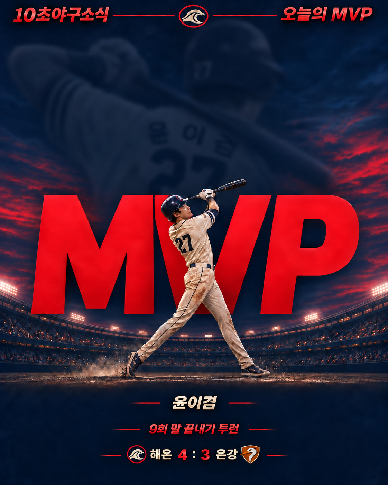

# 작업과정 대화기록 7

10초야구소식 · 윤이겸 MVP 카드 수정과 영상 소재 선택 · 2026-11-25 (KST, 개별 발화 시각 미확인)

영상에 사용할 이미지로 6차 수정본을 선택했다. 영상 편집은 예정 단계다. 이미지 생성 6회. 마지막 선택과 기록 요청은 생성 횟수에서 제외했다.

[](../영상소재/mvp-yoon-v6.png)

### User

````text
이렇개 수정해줘 
````

### 첨부

````text
62545685-380D-4052-B295-CFE6D113A6B6.jpeg · IMG_1286.jpeg
````

### AI

````text
윤이겸 카드의 빨강·네이비 색상과 경기 정보는 살리고, 두 번째 사진처럼 큰 뒷모습과 전신 타격 장면 사이에 ‘MVP’ 글자가 오도록 수정할게요.
````

### 이미지 생성 1

````text
Edit the red Korean card (first image) to adopt the composition of the second image. Portrait 4:5. Baseball editorial poster. Large tightly cropped back view of fictional Korean player 윤이겸 #27 wearing first image's cream and navy uniform and navy helmet, bat diagonally across shoulders, facing the field. Mid layer immense flat red bold block sans-serif MVP in the reference layout. Foreground full-body follow-through swing of same player centered overlapping middle of letters. Deep navy stadium with red dusk horizon. Keep first card's fictional wave and bird badges on the bottom scoreboard, header '10초야구소식' and '오늘의 MVP'. Reserve clear footer for exact text '윤이겸', '9회 말 끝내기 투런', '해온 4 : 3 은강'. Balanced professional typesetting readable at phone size. No real athlete likenesses or real sports or media brands. Match composition rather than copy photo. Output one finished card.
````

### 결과 1

````text
윤이겸 끝내기 투런 MVP 포스터.png
````

### AI

````text
두 번째 참고 이미지의 구도로 수정했어요. 등번호 27이 보이는 윤이겸의 뒷모습을 배경에 크게 배치하고, 빨간 **MVP** 글자 앞으로 전신 스윙 장면이 겹치게 했어요. 하단에는 **‘9회 말 끝내기 투런’**과 최종 점수 **해온 4 : 3 은강**을 담았어요.
````

### User

````text
사람키 180이라고생각하고 비율 조절햊 고 뒤에모습은 그림자처럼 흐린효과 넣어줘 .
````

### AI

````text
앞쪽 선수는 키 180cm의 성인 타자 체형에 맞춰 머리와 팔다리 비율을 조정하고, 뒤쪽 뒷모습은 어두운 네이비 그림자처럼 흐리게 처리할게요.
````

### 이미지 생성 2

````text
Precisely edit the attached finished Korean poster. Make TWO local changes. (1) Foreground full-body swinging player: adjust head relative to shoulders and body, natural balanced proportions of a lean athletic 180cm adult baseball player, about 7.6 heads tall crown to sole excluding raised arms, realistic long legs and anatomically accurate arms, planted feet, consistent #27 jersey, same placement and swing. (2) Upper large back-view portrait ONLY: visually obvious ghosted shadow effect. Strong soft defocus and reduced opacity, desaturate/darken figure into deep navy, low contrast with the stadium, back of helmet, shoulders and diagonal bat barely discernible like a soft photographic silhouette. Remove bright whites and sharp details from this background figure. Keep foreground athlete, large flat red MVP, header, team emblems and bottom scoreboard perfectly sharp. Preserve original poster crop, text content, brand colors and typography, original locations. Korean name 윤이겸, 9회 말 끝내기 투런, 해온 4 : 3 은강. No extra text or height measurement.
````

### User

````text
밑애글씨는 작게해줘
````

### 결과 2

````text
윤이겸의 끝내기 투런과 유령 실루엣.png
````

### AI

````text
하단의 선수 이름, 끝내기 투런 문구, 점수를 한 단계 더 작게 줄일게요.
````

### 이미지 생성 3

````text
Precise typography-only edit to this poster. Reduce all three lines of bottom text substantially. Set '윤이겸' to 55% of its current font size, '9회 말 끝내기 투런' to 65%, and '해온 4 : 3 은강' to 70%. Center each as a compact caption with generous breathing room, maintaining existing colors and correct exact text. Preserve full image above player's feet exactly as in provided image, including red MVP size, foreground adult athlete proportions, shadowy blurred rear portrait, sky, header. Preserve footer logos. Same crop. Output edited poster.
````

### 결과 3

````text
윤이겸 끝내기 투런 야구 포스터.png
````

### AI

````text
하단의 선수 이름과 경기 문구, 점수를 작게 줄였어요. 앞쪽 타자는 키 180cm의 성인 체형을 기준으로 비율을 조정하고, 뒤쪽 뒷모습은 네이비 그림자처럼 흐리게 처리했어요.
````

### User

````text
야자수없애고 경기장 배경을  이어서만들어줘  로고 는 야구단이름옆에넣어줘 
````

### AI

````text
야자수가 있던 자리를 양쪽 관중석과 조명탑으로 자연스럽게 이어 채우고, 하단 로고는 각각 해온과 은강 이름 바로 옆에 붙일게요.
````

### 이미지 생성 4

````text
Edit this exact poster, only two changes. 1. Remove ALL palm trees, trunks, fronds, vegetation silhouettes from both sides. Extend existing baseball stadium stands/upper decks in curved perspective across left and right space with distant stadium lights, continuous dusk sky above, natural scale and matching red/navy grade. 2. Move the TWO detached large bottom corner crests into the centered score line. Use the exact wave crest immediately LEFT of 해온 and the exact orange bird shield immediately RIGHT of 은강. Make both crests small, about 1.4x the team text height, align vertically with the team names, tiny consistent gap. One compact line reading [wave crest] 해온 4 : 3 은강 [bird crest]. Empty outer footer corners in navy; no duplicate bottom emblems. Preserve original header including its small centered mark, player proportions, jersey #27, ghosted blurry back-view, typography, exact small footer name 윤이겸 and 9회 말 끝내기 투런, giant red MVP. Keep framing and portrait aspect ratio. Deliver one card.
````

### 결과 4

````text
해온 4:3 끝내기 승리.png
````

### AI

````text
야자수를 없애고 양쪽 관중석과 조명이 하나의 야구장으로 이어지도록 수정했어요. 하단 점수 줄에는 **해온** 왼쪽에 파도 로고를, **은강** 오른쪽에 새 로고를 붙였어요.
````

### User

````text
mvp 에서 v가 짤렷어
````

### AI

````text
타자에게 가려진 V를 고쳐서 ‘MVP’ 세 글자가 모두 또렷하게 읽히도록 할게요.
````

### 이미지 생성 5

````text
Edit this exact Korean baseball poster. Critical correction: make all three huge red letters MVP completely legible with the V in particular 100% unobstructed, both arms and bottom apex visible. Move the large red MVP title upward into the open upper middle, entirely above the tip of the foreground bat, centered around y=29% of canvas and spanning 76% width, with clear tracking between M, V, P. Remove original red lettering from middle behind batter and continue stadium sky there. Keep the ghosted back view as backdrop behind the new title, with red lettering clearly on top. Keep sharp foreground full-body batter, footer name and scores and logos, stadium and header exactly as before. One red MVP title plus existing small 오늘의 MVP header. Same typographic style, same crop, no new copy.
````

### 결과 5

````text
붉은 MVP 야구 포스터.png
````

### AI

````text
**MVP**를 배트 위로 옮겼어요. 이제 V의 양쪽 획과 아래쪽 끝까지 선명하게 보여요.
````

### User

````text
아니야 난 위에 v자왼쪽윗부분에 빨강 컬러를 조금더 채워달라는말이였지 위로 뽑으라는말이아니였어
````

### 첨부

````text
CD04E59E-573C-490F-871D-05EE95518947.jpeg
````

### AI

````text
제가 MVP 전체를 위로 옮긴 건 잘못 이해했어요. 지금 첨부한 카드에서 선수 헬멧 왼쪽, V의 왼쪽 윗획이 끊긴 부분만 같은 빨강으로 채울게요.
````

### 이미지 생성 6

````text
Use attached poster as exact base. Surgical tiny paint repair only. At the batter's helmet immediately to its LEFT the red V LEFT stroke has an erroneous horizontal cut around y=628, 64px lower than the top of adjacent red M and P at y=564 (1122px wide image). Paint missing small red section behind helmet in x approx 450-505, y 564-628 continuing the visible red left arm of V up to the M cap height. Keep thin dark gap to right of M. Ensure an obvious narrow red patch visible to LEFT of helmet at top. Draw behind player so helmet silhouette stays in front. Keep MVP at its EXACT existing mid-poster position behind figure, same type scale, same bottom edge, same outlines elsewhere. All remaining source artwork and lettering and colors identical. Do not recompose, do not raise the word. Output full poster.
````

### 결과 6 · 영상 소재 채택

````text
MVP 야구 포스터 속 타자.png
````

### AI

````text
선수 헬멧 왼쪽에 보이는 **V의 윗부분만** 빨강으로 채워 M과 높이를 맞췄어요. MVP는 원래처럼 선수 뒤 중앙에 배치했어요.
````

### User

````text
마지막꺼 영상 소재로 넣을꺼야 . 지금까지 대화 기록 해주고.  커밋해줘
````

